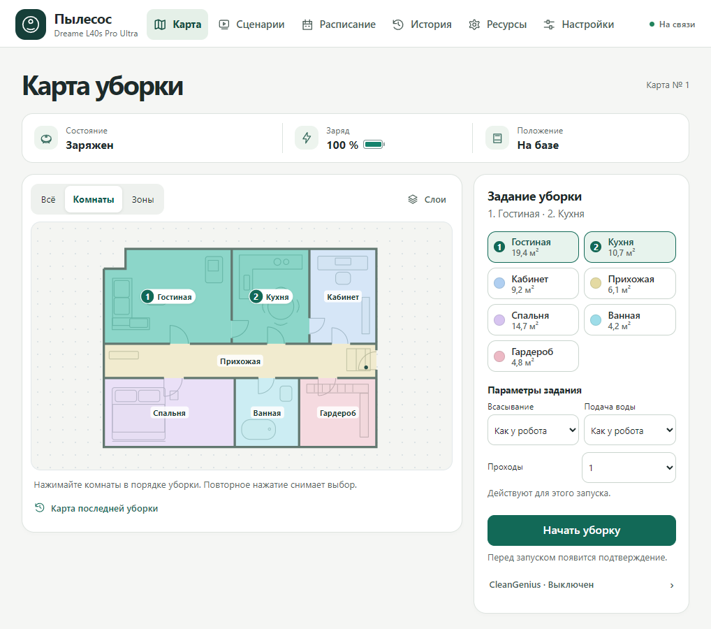
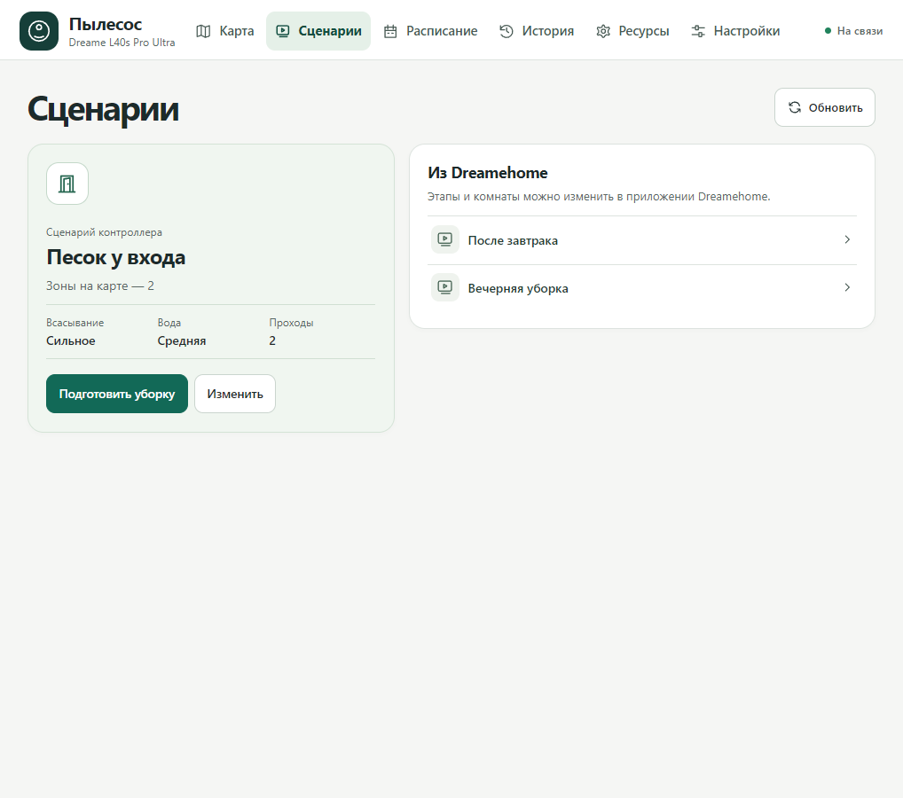
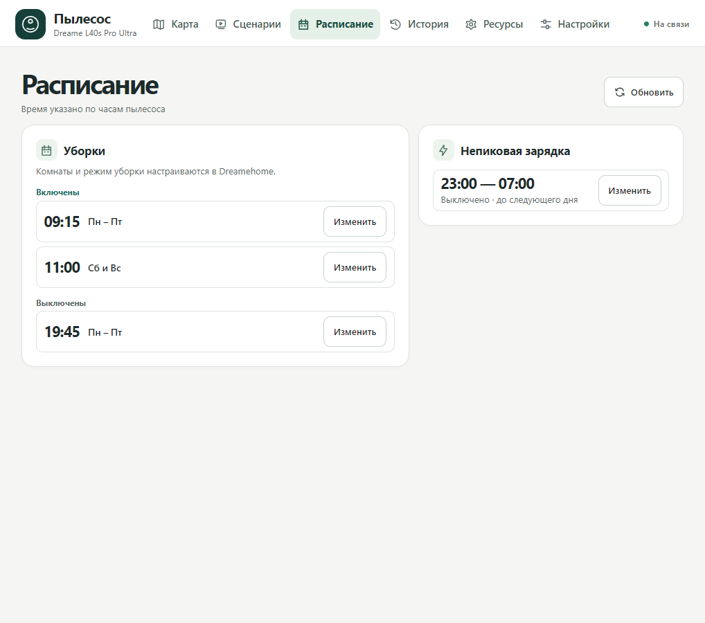
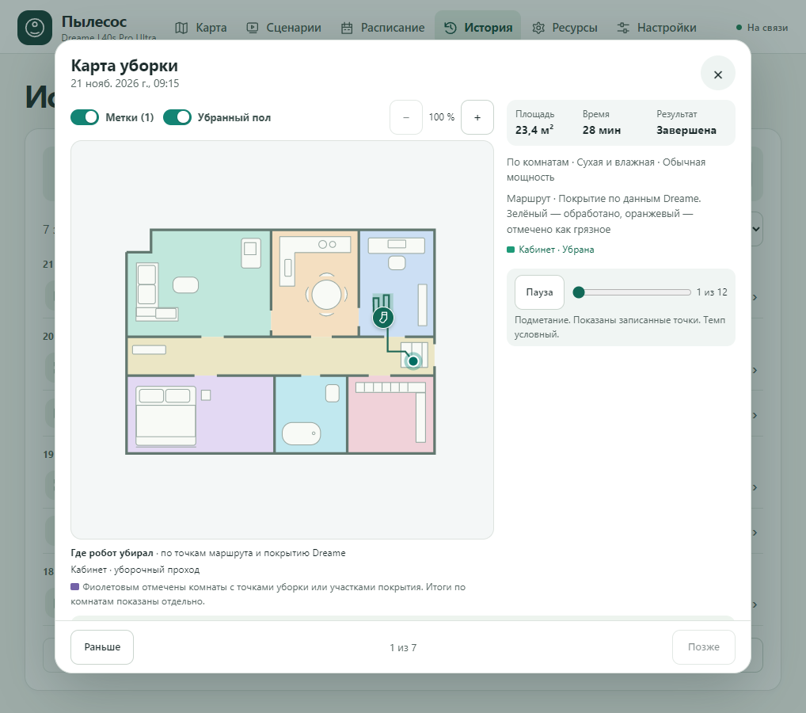
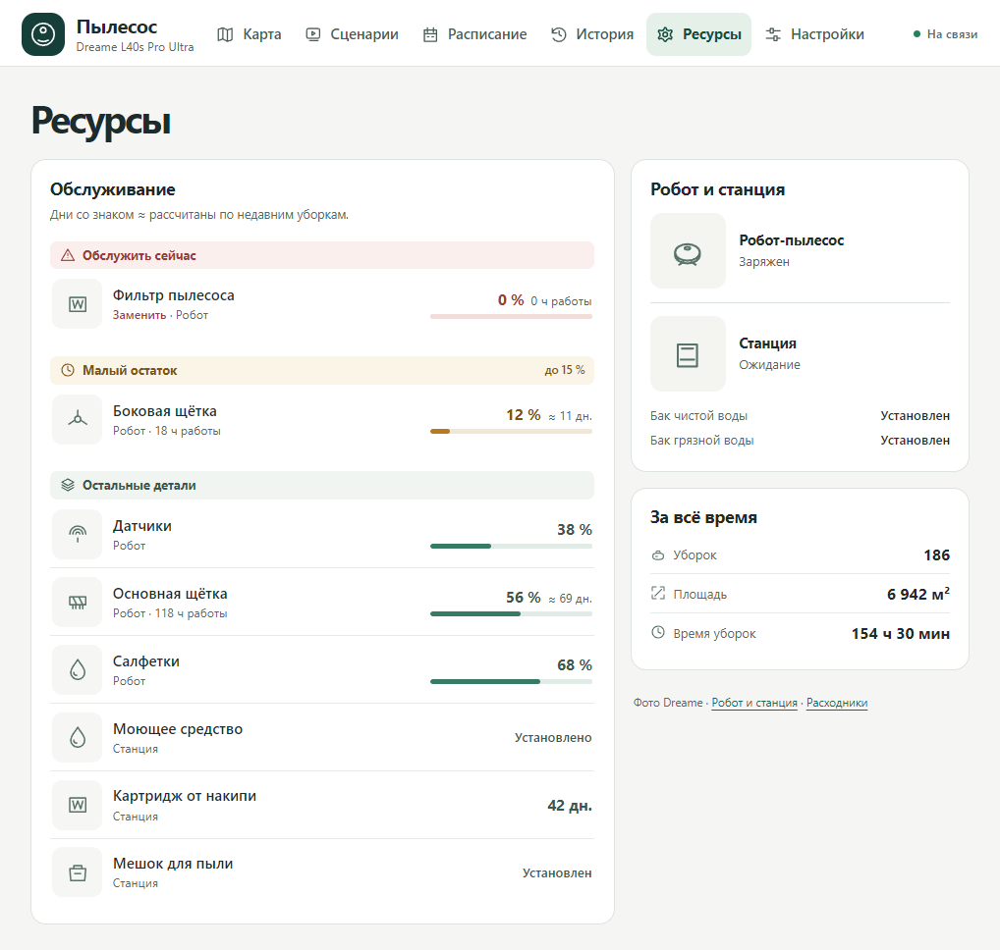

# Панель Dreame в Wiren Board

Открой **Интеграции → Пылесос**. Ниже показаны примеры с вымышленной квартирой и демонстрационными показаниями.

## Карта и разовая уборка

Нажимай на комнаты в нужной последовательности. Если исключить комнату в середине, номера остальных обновятся. Для уборки по координатам переключись на «Зоны». Потяни за середину прямоугольника, чтобы его сдвинуть, за боковую грань или угол — чтобы изменить размер. Крестик удаляет выделенную зону. Последнее удаление можно отменить прямо на карте. В одно задание входит до десяти зон. Для отправки задания нажми «Начать уборку» и проверь выбранные помещения в подтверждении.

[Как карта выглядит на телефоне](images/map-mobile.png)

## Сценарии

На вкладке «Сценарии» открой «Песок у входа», выдели зоны и выбери мощность, воду и число проходов. «Сохранить сценарий» запоминает их на контроллере. «Как у робота» применяет значение, которое будет у робота в момент запуска. Чтобы убраться, нажми «Подготовить уборку» и подтверди задание. При кратком обрыве связи черновик сохраняется в открытой панели. Если робот подтвердил другую карту, выдели участок заново.

Сценарии, созданные в Dreamehome, отображаются в этом же разделе. Выбери, например, свою уборку кухни после еды. Панель покажет цель и число этапов перед запуском.

## Расписание

Открой карточку нужной уборки. Для поддерживаемых повторяющихся заданий можно изменить время, дни недели и включение, создать выключенную копию или удалить запись с подтверждением. У копии сохраняется задание исходной уборки. Если задание уже поменялось в приложении, панель предупредит перед записью. Время указано по часам пылесоса. В блоке зарядки интервал вроде «23:00–07:00» заканчивается на следующий день.

## История и доуборка

Нажатие на запись открывает её карту. В окне можно проследить маршрут и посмотреть участки влажной уборки. Если Dreame передал фотографию препятствия, нажми на его значок. Кнопка «Доубрать» работает с последней уборкой при подтверждённых пропусках или загрязнениях. Перед отправкой панель проверит, подходит ли текущая карта.

## Ресурсы

Панель группирует детали по необходимости обслуживания. Цвет сопровождают подпись и остаток. Проценты, часы работы и прямые показания в днях приходят от робота. Знак «≈» у щёток и фильтра обозначает оценку календарного срока при прежней нагрузке. Она появляется при достаточной истории уборок. Совместимые детали, по которым робот ничего не сообщил, можно посмотреть отдельно.

Снимок ниже показывает, как выглядит раздел с локальными пиктограммами. При доступе к сайту производителя на L40s Pro Ultra загружаются фотографии конкретных деталей, робота и станции. [Источники фотографий](PRODUCT_PHOTOS.md)

## Где какие настройки

| Что меняешь | Где сохраняется |
| --- | --- |
| Участок и параметры «Песка у входа» | В сценарии на WB |
| Мощность и вода в разовом задании | В параметрах этого запуска |
| CleanGenius и параметры вкладки «Настройки» | На роботе после подтверждения |
| Названия комнат и расположение разделов панели | В штатном конфигураторе WB рядом с интервалом опроса |

В **Настройки → Конфигурационные файлы → Пылесос Dreame** поле **Разделы панели пылесоса** позволяет выбрать «Автоматически», «Сверху» или «Слева». В автоматическом режиме внутри Wiren Board разделы находятся сверху. Если открыть панель отдельно, на широком экране появится левое меню. Выбранный вручную вариант «Слева» действует при ширине содержимого от 1000 пикселей. На телефоне разделы остаются сверху. В конфигураторе можно также дать комнате своё имя, например изменить «Kitchen» на «Кухня».

[Установка, подключение, каналы MQTT и возврат к предыдущей версии](../README.md)
